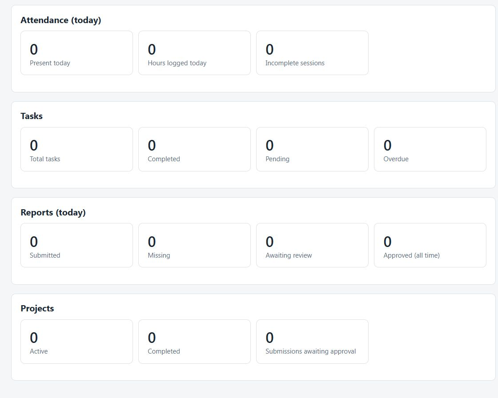

# IOPMS — Intern Operations & Performance Management System

Internal web platform for **Valen Labs** to manage interns: attendance & working hours,
task allocation, daily reports, project submissions, an admin dashboard and a
consolidated per-intern report with CSV export.

**Stack:** Java 21 · Spring Boot 3.4 · Spring Data JPA · Spring Security (JWT) ·
PostgreSQL (Supabase) · plain HTML/CSS/JS · Maven · Swagger · Postman



## Features (7 modules)

| Module | Highlights |
|--------|-----------|
| **A. Auth & users** | BCrypt hashing, JWT + roles, intern CRUD/deactivate, profile self-edit. Passwords never leave the backend (only hashes stored). |
| **B. Attendance** | Start/End work, **server clock only**, one open session at a time, no end-without-start, backend-computed minutes, monthly totals, admin corrections with mandatory reason + audit history. Interns have no endpoint that writes timestamps. |
| **C. Tasks** | Admin creates/assigns with priority, dates, status, remarks. Interns update progress; only admins may set COMPLETED / CHANGES_REQUESTED. |
| **D. Daily reports** | One report per intern per date (DB unique index), approve / request-changes with remarks, missing-report listing. |
| **E. Projects** | Multi-intern assignment, supervisor, dates; deliverable submissions (repo URL + notes) with **automatic version numbers** and review feedback. |
| **F. Admin dashboard** | Team, attendance, task, reporting and project counters — computed server-side. |
| **G. Intern report** | One consolidated payload per intern (profile, attendance, tasks, reports, submissions, feedback) with month filter + **CSV export**. |

## Quick start

### Option 1 — local, zero setup (H2)

```powershell
# Windows PowerShell: keep the -D flag quoted, or PowerShell splits it on the dots
mvn spring-boot:run "-Dspring-boot.run.profiles=dev"
```

```bash
mvn spring-boot:run -Dspring-boot.run.profiles=dev     # macOS / Linux
```

### Option 2 — Supabase (PostgreSQL)

```powershell
.\run-supabase.ps1     # prompts for the DB password, generates a JWT secret
```

The Supabase **direct connection is IPv6-only** (unreachable from most local networks) —
the script uses the **transaction pooler** instead (IPv4, port 6543,
username `postgres.<project-ref>`). Manual equivalent and full notes:
[Supabase setup](#supabase-setup).

### Log in → http://localhost:8080

Both panels share one login page; the app routes you by role:

| Panel | Email | Password | Lands on |
|-------|-------|----------|----------|
| Admin | `admin@valenlabs.com` | `Admin@123` | Dashboard · Interns · Attendance · Tasks · Reports · Projects · Intern Report |
| Intern | `ayush@valenlabs.com` | `Intern@123` | Profile · Attendance · Tasks · Daily Report · Projects |

> Demo intern is created by an admin from the **Interns** tab on a fresh database.
> Log out (top right) to switch panels.

### Supabase setup

1. Create a Supabase project (note its region, e.g. `ap-northeast-1`).
2. Copy the **Transaction pooler** connection string from Dashboard → Connect.

```bash
# macOS / Linux (Windows: use run-supabase.ps1)
export DB_URL="jdbc:postgresql://aws-0-<region>.pooler.supabase.com:6543/postgres?sslmode=require&prepareThreshold=0"
export DB_USER=postgres.<project-ref>
export DB_PASSWORD=<database-password>
export JWT_SECRET=<random-string-at-least-32-bytes>
mvn spring-boot:run     # no dev profile — that would switch back to H2
```

First boot creates all tables (`ddl-auto=update`) and seeds the admin.
Schema reference: [`schema-postgres.sql`](schema-postgres.sql).

## Testing

```bash
mvn test     # 14/14 green
```

| Suite | Covers |
|-------|--------|
| `AttendanceServiceTest` (Mockito) | one-open-session rule, end-without-start, server-side hour computation, correction recompute + audit row, invalid correction rejected |
| `AppFlowTest` (HTTP e2e + H2) | admin login → create intern → role isolation (403/401) → start/end rules → audited correction (480 min) → task progress rules → one-report-per-day (409) → report review → versioned submissions → dashboard numbers → consolidated report + CSV |

## API documentation

- **Swagger UI:** http://localhost:8080/swagger-ui.html
- **Postman:** [`postman/IOPMS.postman_collection.json`](postman/IOPMS.postman_collection.json)
  (the collection `token` variable is filled automatically by the login requests)

## Documentation

- [`docs/ARCHITECTURE.md`](docs/ARCHITECTURE.md) — layers, data model, design decisions, security, environments
- [`schema-postgres.sql`](schema-postgres.sql) — full database schema
- [`docs/screenshots/`](docs/screenshots/) — module screenshots

## Repository structure

```
iopms/
├── README.md                  ← you are here
├── docs/
│   ├── ARCHITECTURE.md        system architecture & design decisions
│   └── screenshots/           working-module screenshots
├── schema-postgres.sql        authoritative DB schema (PostgreSQL)
├── postman/                   Postman collection
├── run-supabase.ps1           one-command Supabase start
└── src/
    ├── main/java/com/valenlabs/iopms/
    │   auth/ user/ attendance/ task/ report/ project/ admin/ intern/ common/
    └── main/resources/static/ index.html (login), admin.html, intern.html, style.css, *.js
```

## Deliverables

- [x] Working backend (all 7 modules) + frontend
- [x] Database schema (`schema-postgres.sql`)
- [x] Supabase (PostgreSQL) integration
- [x] README with setup instructions
- [x] Postman API collection
- [x] Swagger documentation (auto-generated)
- [x] Test cases — `mvn test` → **14/14 passing**
- [x] System architecture document ([`docs/ARCHITECTURE.md`](docs/ARCHITECTURE.md))
- [x] Screenshots of working modules ([`docs/screenshots/`](docs/screenshots/))
- [ ] Walkthrough video (record with Win+G / OBS:
      Admin Dashboard → Interns → Attendance → Tasks → Reports → Projects → Intern portal)
